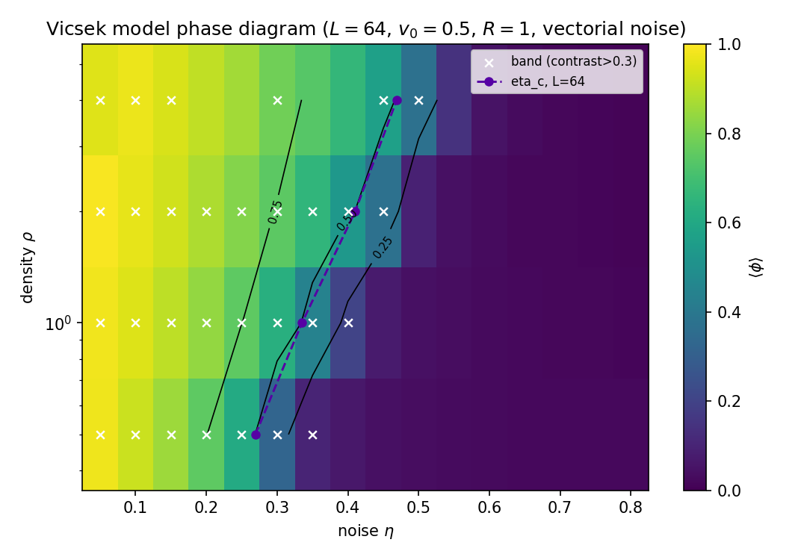
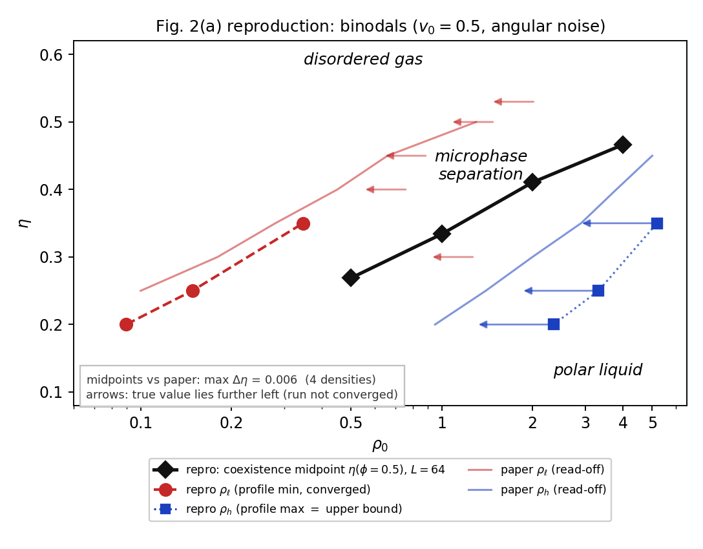
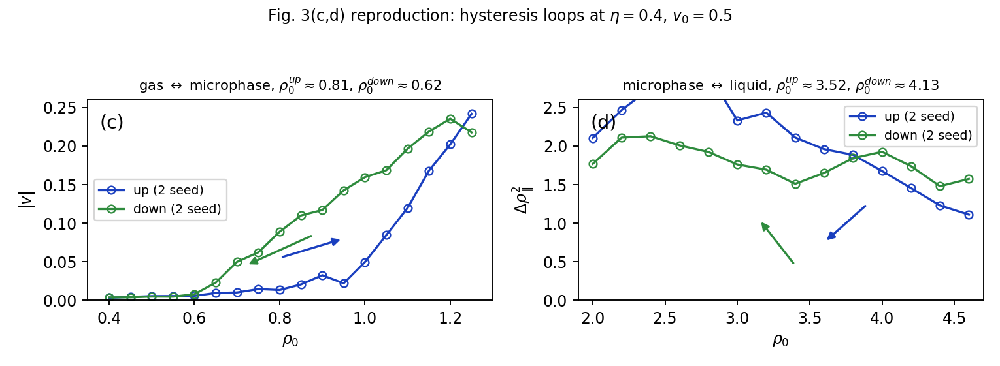
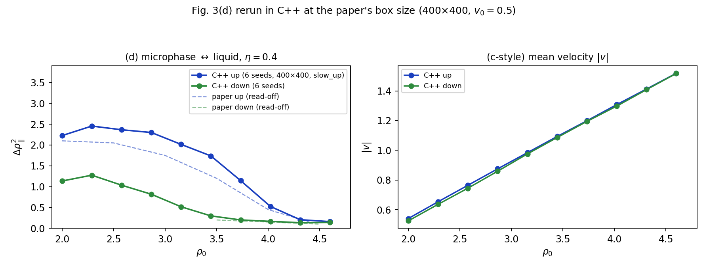
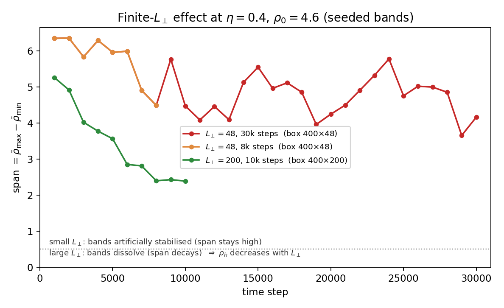

把 Solon、Chaté 与 Tailleur 在 <em>PRL</em> <strong>114</strong>, 068101 (2015) 里的相分离图像重算一遍。 
下面是项目内容、模型、代码和复现结果。

## 项目内容

那篇 PRL 的核心主张是：Vicsek 模型的"有序—无序转变"不是普通的连续相变，而是**一级相变 + 微相分离**。均匀有序相（Toner-Tu 相 / 极性液体）与无序气相之间隔着一段共存区，共存区里系统自发排成周期排列的有限宽"带"。

复现目标为论文中的三张图：

| 论文 panel | 内容 | 做法 |
|---|---|---|
| Fig 2(a) | binodal 相图：$\rho_\ell(\eta)$（气体侧）与 $\rho_h(\eta)$（液体侧） | 一次共存区长程运行，取带剖面的谷值与峰值 |
| Fig 3(c) | $\eta=0.4$ 下气体 ↔ 微相分离的滞后回线 | 密度 ramp，400×100，2 seeds |
| Fig 3(d) | $\eta=0.4$ 下微相分离 ↔ 极性液体的滞后回线 | 密度 ramp，400×400（C++），6 seeds |

## 模型

角噪声（scalar / angular noise）Vicsek 模型，对应论文式 (1)。所有粒子用 $t$ 时刻的信息**平行更新**：

$$
\theta_i(t+1)=\mathrm{Arg}\Big(\sum_{j\in S_i}\mathbf{v}_j(t)\Big)+\eta\,\xi_i,
\qquad
$$
$$
\mathbf{x}_i(t+1)=\mathbf{x}_i(t)+v_0\,\mathbf{e}_i(t+1)
$$ {#eq-vicsek}

- $S_i$：与粒子 $i$ 距离 $\le R$ 的所有粒子，周期边界取最小镜像约定；
- $\xi_i$：$[-\pi,\pi]$ 上均匀分布的随机角，噪声幅值为 $\eta\pi$，$\eta\in[0,1]$；
- 标准参数：$v_0=0.5$、$R=1$、$\Delta t=1$；初态为随机位置和随机取向，也就是"从无序出发"。

## 代码结构

| 文件 | 属于 | 做什么 |
|---|---|---|
| `vicsek.py` | v1（方形盒） | 模型核心：精确邻域搜索、观测量、单点 CLI、自检 |
| `scan.py` | v1 | 并行网格扫描（多进程/线程、断点续跑、`--quick` / `--dense`） |
| `analyze.py` | v1 | 相图绘图 + $\eta_c$ 提取 |
| `vicsek_rect.py` | v2（矩形盒） | 加上任意 $L_\parallel\times L_\perp$ 与 `ramp_run` 密度 ramp 协议 |
| `vicsek_ramp.cpp` | v2（C++ 加速） | 换成c++跑fig3（d）|
| `campaign.py` | 复现流水线 | 批量跑 Fig 2(a) / Fig 3(c,d) 的任务 |
| `plot_cpp_fig3d.py` | 复现流水线 | 出 Fig 3(d) 的 C++ 对照图 |

`sim/` 目录里有一套从头写的带测量工具（`vicsek_bands.cpp`）。它测共存区里一条带的宽度与密度，用来验证噪声降低时一条带的质量在变小。

## 复现结果

### 相图中的点

用 $L=64$ 方形盒、随机初态扫描每个密度的 $\varphi=0.5$ 中点，与论文相图两条曲线的窗口中点对比：

| $\rho_0$ | 复现$\eta(\varphi=0.5)$ | 论文窗口 | 论文中点 |
|---|---|---|---|
| 0.5 | 0.270 | (0.12, 0.43) | 0.275 |
| 1.0 | 0.335 | (0.21, 0.47) | 0.340 |
| 2.0 | 0.410 | (0.30, 0.52) | 0.410 |
| 4.0 | 0.470 | (0.41, 0.53) | 0.470 |

四个密度全部吻合到 0.01 以内。

{#fig-phase fig-alt="相图热力图与转变线"}

### 与论文 Fig 2(a) 的对照

{#fig-fig2a fig-alt="复现相图与论文 Fig 2(a) 的对照"}

气体侧 $\rho_\ell(\eta)$ 在 $\eta\le0.35$ 收敛得很好（$\eta=0.20$：0.089；$\eta=0.25$：0.148；$\eta=0.35$：0.31–0.44）。$\eta\ge0.4$ 的点系统性偏高 20–40%，原因可能是气体背景在给定步数内还没有完全稀释

### 滞后回线：气体 ↔ 微相分离（Fig 3(c)）

$\eta=0.4$，400×100，2 seeds：

| 量 | 复现 | 论文（400×400，100 runs） |
|---|---|---|
| 上行支成核 $\rho_0$ | 0.81–0.95 | 0.90 |
| 下行支消失 $\rho_0$ | 0.62–0.70 | 0.75 |
| $\lvert v\rvert$（$\rho_0=1.25$） | 0.24 | 0.23 |

两支的相对位置、弯曲形状、右端汇合都与论文截图一致；滞后略宽，来自 seeds 数与 $L_\perp$ 的差异。

{#fig-fig3cd fig-alt="气体与微相分离之间的滞后回线"}

### 滞后回线：微相分离 ↔ 极性液体（Fig 3(d)）

这一张最初是失败的：在 400×48 的窄盒子里，上行支无论如何都不崩塌，看起来像"$\rho_h>5.5$"。换成论文规格 400×400、每点 8000 步、上行用 3 条带种子、6 seeds 之后：

| $\rho_0$ | 上行支 $\Delta\rho_\parallel^2$ | 下行支 | 论文读数 |
|---|---|---|---|
| 2.00 | $2.23\pm0.04$ | 1.14 | ~2.1 |
| 2.87 | $2.30\pm0.11$ | 0.82 | ~2.1 |
| 3.44 | $1.74\pm0.17$ | 0.30 | ~1.9 |
| 4.02 | $0.52\pm0.15$ | 0.17 | ~1.2 |
| 4.60 | $0.16\pm0.05$ | 0.14 | ~0.15 |

{#fig-fig3d fig-alt="微相分离与极性液体之间的滞后回线"}

### 液体侧 binodal：为什么不能用剖面峰值

最开始的做法是错的：把带剖面的峰值当作 $\rho_h$。小 $L_\perp$ 盒子里带被挤压，峰值会系统性偏高约一倍（$\eta=0.2$ 给 2.35，论文约 0.95；$\eta=0.35$ 给 5.19，论文约 2.9）。

换用带稳定性判据、并做 $L_\perp$ 扫描后：

| 盒子 | span 演化（30000 步内） | 判定 |
|---|---|---|
| 400×48 | 6.35 → 4.16，无趋势（均值 5.03） | 不溶解——窄盒子人为稳定带 |
| 400×200 | 5.26 → 3.56 → 2.39 单调衰减 | 正在溶解 |
| 400×400（C++ ramp） | 下行支 $\rho\ge3.7$ 时 $\Delta\rho_\parallel^2=0.14$–0.18 | 已均匀 |

{#fig-rhoh fig-alt="不同横向盒宽下带密度的演化"}

## 修正

同一个状态点（$\eta=0.4$、$\rho_0=2.87$），三种协议给出三个差别很大的 $\Delta\rho_\parallel^2$：

| 上行支协议 | $\rho_0=2.87$ 处的 $\Delta\rho_\parallel^2$ | 现象 |
|---|---|---|
| 每点 4000 步、播 2 条带 | 3.56 | 带被压缩（还没弛豫），偏高 |
| 每点 8000 步、播 3 条带 | 2.30 | 与论文的 2.1 吻合 |
| 单点充分弛豫（3000+ 步自由演化） | 1.24 | 带展宽、气体密度升到 1.65，偏低 |

论文的 2.1 落在中间，ramp 足够慢，让带数能随密度自己调整。所以播种的带数应该按自然带数取：

$$
n_b=\frac{L_\parallel\,(\rho_0-\rho_{\rm gas})}{\mu}
$$ {#eq-band}

否则带会被盒子挤住。

## 复现结论

比较成功的：

- 相图中点：四个密度的 $\eta(\varphi=0.5)$ 与论文窗口吻合到 0.01 以内；
- Fig 3(c)：跃变位置与幅度在 0.05–0.1 以内；
- Fig 3(d)：上行支平台、高密度端、下行支高密度侧都对上；
- 带态定量：$\eta=0.40$、$\rho_0=1.93$、800×100 下 $\rho_{\rm gas}=0.622$（论文 0.606，差 2.6%）、峰值 4.82（论文 $\approx4.5$）、$n_b=6$（论文 $\approx6$）；自洽检查 $L_x(\rho_0-\rho_{\rm gas})/n_b=174.4$ 与实测的 $m_b/L_\perp=174.4$ 一致；
- 三个相区、两条 binodal 的形状、带的共存机制、双向滞后——定性复现了。

问题：

- $\rho_\ell(\eta\ge0.4)$ 偏高 20–40% 
- Fig 3(d) 上行支崩塌偏平缓 
- 下行支低密度端 1.1–1.3
- 滞后宽度偏大 

论文 Fig 3(c,d) 用 400×400 盒子 + 100 runs，我这边是 16 核、纯 NumPy,没 GPU，也没装 numba）。把 400×400 跑到收敛大约要 17 小时一条 ramp，所以对 $L_\perp$ 和步数做了缩减,这直接导致高密度支没有到平衡。

## 代码与文献

**代码**：本页对着的源码都在仓库的 `projects/vicsek-model/code/` 下（`vicsek.py`、`vicsek_rect.py`、`scan.py`、`analyze.py`、`vicsek_ramp.cpp`、`campaign.py`、`plot_cpp_fig3d.py`），目录说明见同目录的 `README.md`。

**文献**：

- Solon, Chaté & Tailleur, *From Phase to Microphase Separation in Flocking Models: The Essential Role of Nonequilibrium Fluctuations*, **PRL 114**, 068101 (2015) 
- Ginelli & Chaté, *Relevance of metric-free interactions in flocking phenomena*, **EPJ ST 225**, 2099 (2016) 

<a class="section-link" href="../index.html">← 返回 Projects</a>

